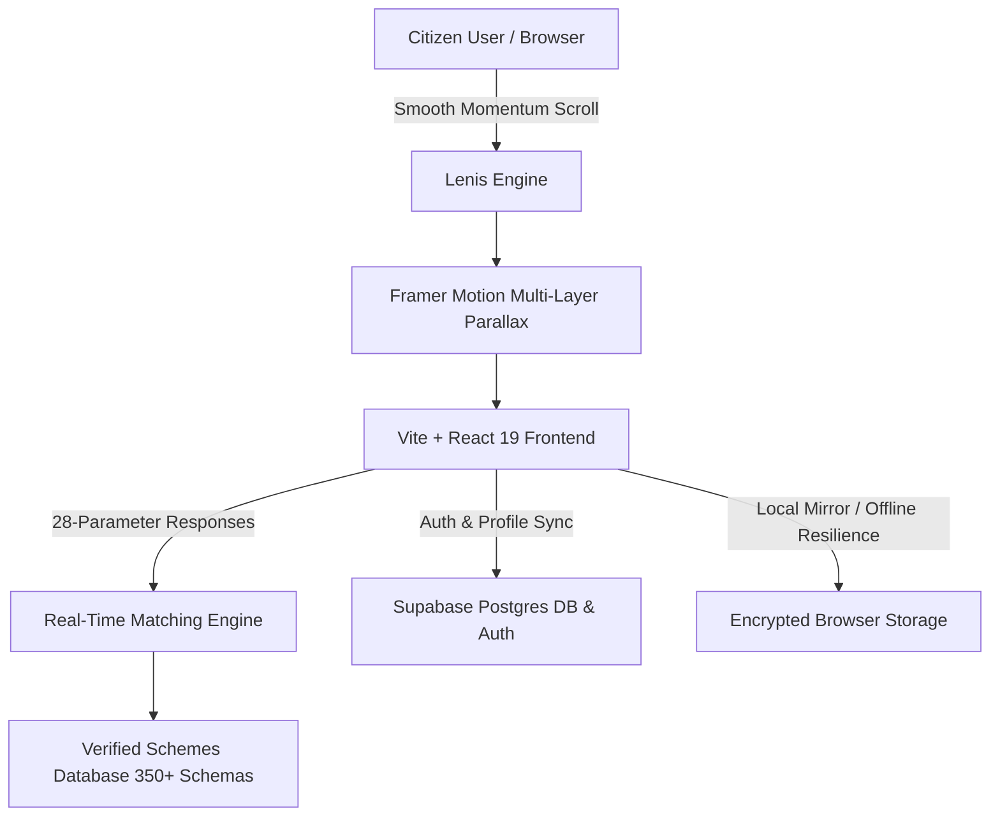

# Scheme Sathi — Comprehensive System Documentation & Technical Specification

## 1. Executive Overview

**Scheme Sathi** is an intelligent, real-time national welfare and grant discovery engine engineered for 1.4 billion Indian citizens. The platform dynamically matches users against **Central, State, and Corporate CSR schemes** using a multidimensional 28-parameter rule-based eligibility engine.

The system empowers:
- **Annadata Farmers & Cultivators** (PM-KISAN, PMFBY, PM-KUSUM, Kisan Credit Card)
- **Students & Research Scholars** (NSP Central Sector, AICTE Pragati, Tata Trusts, Reliance Foundation)
- **MSME Entrepreneurs & Traditional Artisans** (PMMY MUDRA, PMEGP 35% Capital Subsidy, PM Vishwakarma, Stand-Up India, PM SVANidhi)
- **Women & Child Welfare** (Sukanya Samriddhi 8.2% EEE, PMMVY ₹6k Maternity DBT, PM Ujjwala 2.0)
- **Healthcare & Senior Citizens** (Ayushman Bharat PM-JAY ₹5L Cashless, Atal Pension Yojana)
- **Differently-Abled Citizens (UDID)** (Divyangjan Swavalamban Soft Loans, ADIP Assistive Aids)

---

## 2. Technical Architecture & Tech Stack



### Core Technologies:
- **Frontend Framework**: React 19 + TypeScript
- **Bundler & Dev Server**: Vite 8 with HMR
- **Smooth Momentum Scrolling**: [Lenis](https://lenis.dev/) v1.1
- **Animation & 3D Physics**: Framer Motion 13 (3D Perspective, Spring Damping, Dynamic Specular Glares)
- **Styling**: TailwindCSS 3.4 with custom glassmorphism and obsidian twilight palette
- **Icons**: Lucide React
- **Cloud Database & Auth**: Supabase (PostgreSQL + RLS + GoTrue Auth)

---

## 3. Real-Time Eligibility Matching Engine

The core evaluation algorithm in `src/utils/matchingEngine.ts` processes a citizen's profile across 28 parameters:

$$\text{MatchScore} = \sum_{k=1}^{n} w_k \cdot \mathbb{I}(\text{Criterion}_k)$$

Where weights $w_k$ are assigned to:
1. **Demographic Fit** (Age brackets, gender, domicile state, rural/urban classification, caste/category).
2. **Economic Threshold** (Annual household income ceilings, BPL/Antyodaya status, tax-filing status).
3. **Domain Qualifications**:
   - **Agriculture**: Landholding (acres), crop types (Kharif/Rabi/Horticulture), irrigation source, KCC status.
   - **Academics**: Current level (10th/12th/UG/PG), board percentage, STEM/Technical degree, institution accreditation.
   - **Enterprise**: Micro/Small/Medium scale, Udyam registration, greenfield venture, traditional artisan trade (18 notified crafts).
   - **Health & Disability**: Benchmark disability percentage (40%+ UDID), chronic condition, hospitalization need.

---

## 4. Verified National Schemes Dataset

All schemes in `src/data/schemesData.ts` contain verified government data:

| Scheme Name | Ministry / Authority | Benefit Amount | Category | Official Portal |
|---|---|---|---|---|
| **PM-KISAN** | MoA&FW | ₹6,000 / year (3 installments) | Farmers | `pmkisan.gov.in` |
| **Ayushman Bharat PM-JAY** | National Health Authority | ₹5,00,000 / year cashless | Healthcare | `beneficiary.nha.gov.in` |
| **PM MUDRA Yojana** | Ministry of Finance | Up to ₹20,00,000 collateral-free | MSME | `mudra.org.in` |
| **PMEGP** | KVIC / MoMSME | 15% - 35% Capital Subsidy | MSME | `kviconline.gov.in` |
| **PM Vishwakarma** | MoMSME | ₹15k Toolkit + ₹3L @ 5% loan | Artisans | `pmvishwakarma.gov.in` |
| **Sukanya Samriddhi Yojana** | Dept of Posts / MoF | 8.2% Compound Interest (EEE) | Women / Girls | `indiapost.gov.in` |
| **PMAY (Housing for All)** | MoHUA / MoRD | ₹1.2L - ₹2.67L Pucca Subsidy | Housing | `pmay-urban.gov.in` |
| **PM-KUSUM** | MNRE | Up to 90% Solar Pump Subsidy | Farmers | `pmkusum.mnre.gov.in` |
| **NSP Central Sector** | Ministry of Education | ₹12k - ₹20k / year | Students | `scholarships.gov.in` |
| **AICTE Pragati** | AICTE | ₹50,000 / year (4 years) | Girls in STEM | `aicte-india.org` |
| **PM SVANidhi** | MoHUA | ₹10k - ₹50k with 7% subvention | Street Vendors | `pmsvanidhi.mohua.gov.in` |
| **Atal Pension Yojana** | PFRDA | ₹1k - ₹5k lifetime pension | Seniors / Unorganized | `npscra.nsdl.co.in` |
| **Divyangjan Swavalamban**| NHFDC | ₹25 Lakh soft loan @ 4%-8% | Differently-Abled | `nhfdc.nic.in` |

---

## 5. Security & Authentication Architecture

### Duplicate Registration Prevention:
1. When a citizen submits a registration form, the backend registry strictly queries existing records in **Supabase PostgreSQL** and local encrypted registries.
2. If an existing account with the same normalized email (`email.toLowerCase().trim()`) is found, the system rejects the duplicate attempt with an explicit status message and prompts immediate login.
3. Upon first-time successful registration, the citizen profile is instantly created, authenticated, and redirected to the live eligibility wizard with zero demo delay.

---

## 6. Running Locally & Development

```bash
# 1. Install dependencies
npm install

# 2. Run local development server with Vite
npm run dev

# 3. Compile and build production bundle
npm run build
```

---
*Documentation Version 2.4 — Scheme Sathi Public Public Infrastructure Initiative*
